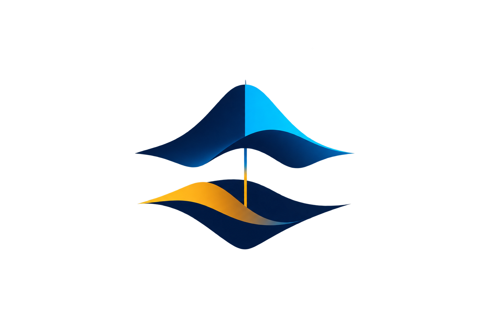

# آزمون‌های آزمایشی هوش مصنوعی

مخزن تسک‌های تمرینی سطح‌بندی‌شده برای آمادگی آزمون عملی هوش مصنوعی.

## تسک‌ها

- [فرودِ جعبه‌ی سیاه](فرود%20جعبه%20سیاه/README.md) — رگرسیون سطح ۱ و مهندسی ویژگی.
- [نبضِ نیروگاه سپهر](نبض%20نیروگاه%20سپهر/README.md) — بازطراحی Q1 سال قبل با پاک‌سازی داده، نمودار و مهندسی ویژگی.
- [ردپای سایه‌ها](ردپای%20سایه‌ها/README.md) — طبقه‌بندی تراکنش نامتوازن با KNN و PCA از صفر.

**محرمانگی:** solutionها و برچسب‌های test خصوصی‌اند و در Git نادیده گرفته می‌شوند. پوشهٔ `private/` و `solution.ipynb` را منتشر نکنید.

- [چشم فولادی](چشم%20فولادی/README.md) — تشخیص شش بافت فولاد با ویژگی‌های تصویری و MLP.
